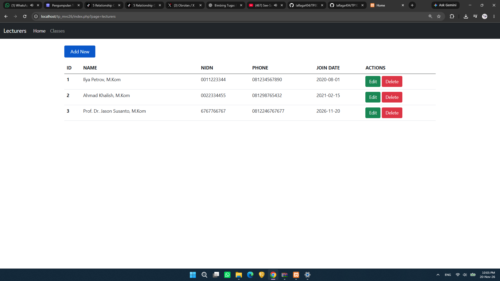
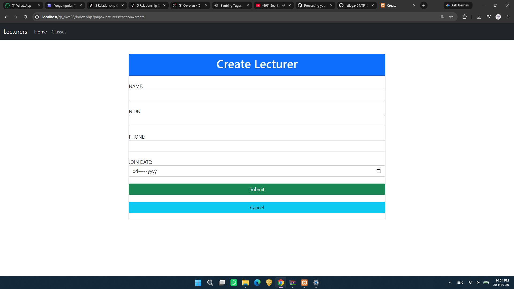
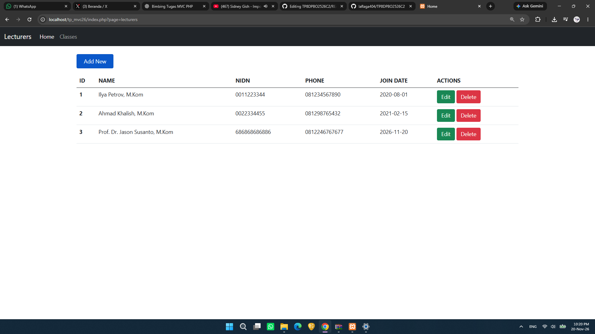
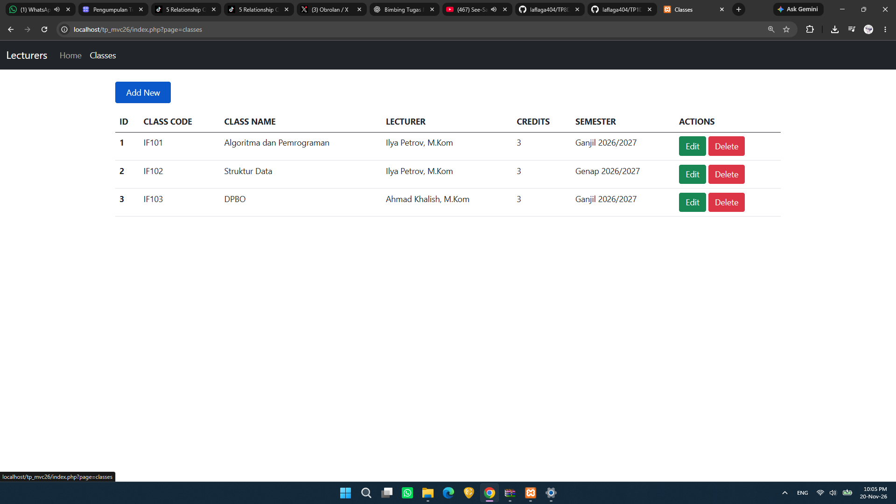
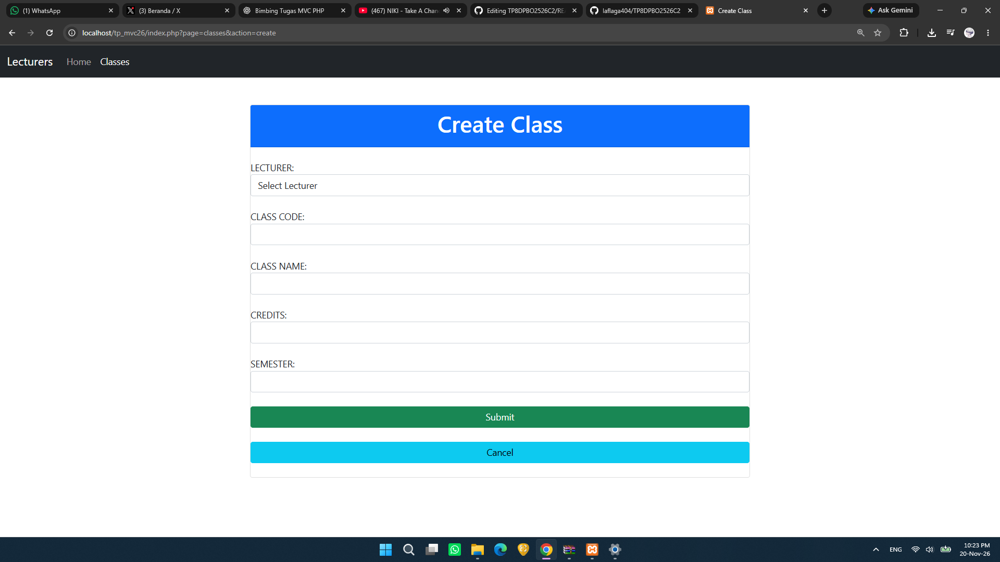
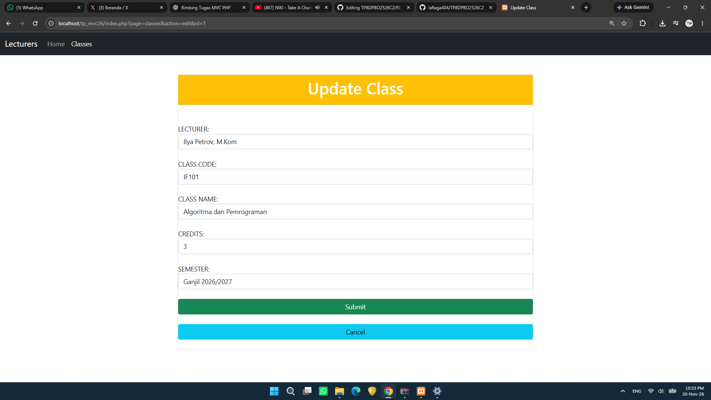
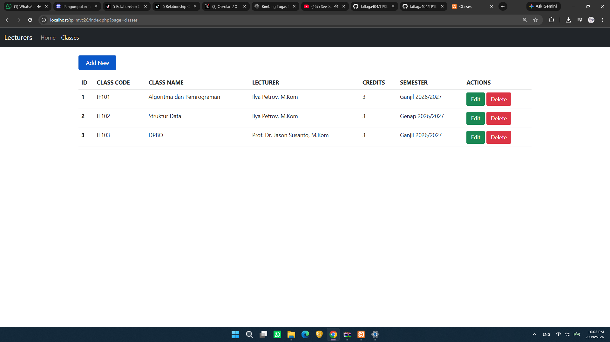
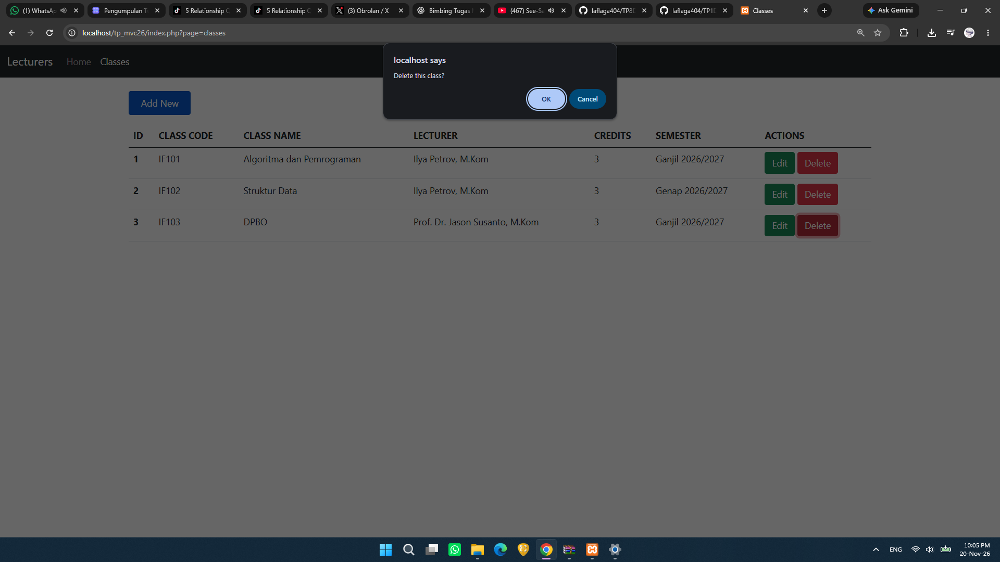
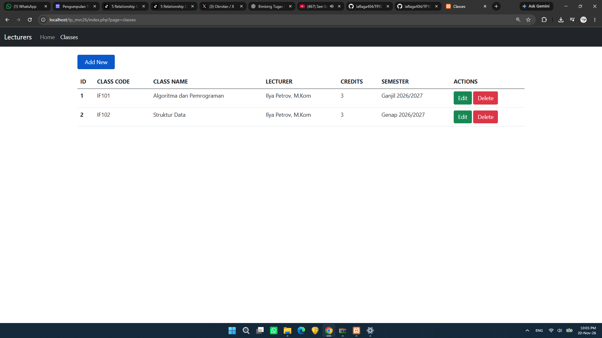

# TP8DPBO2526C2

## Janji

Saya Nabil Azka Saputra dengan NIM 2507096 mengerjakan Tugas Praktikum 8 pada Mata Kuliah Desain dan Pemrograman Berorientasi Objek untuk keberkahan-Nya maka saya tidak melakukan kecurangan seperti yang telah dispesifikasikan. Aamiin

## Deskripsi Program

Program ini merupakan aplikasi **Lecturer Management System** yang dikembangkan dari starter project PHP untuk mengelola data dosen (*lecturers*). Project menerapkan arsitektur **Model-View-Controller (MVC)** menggunakan PHP Native dan MySQL/MariaDB.

Selain pengelolaan data dosen, program memiliki fitur pengelolaan **Classes**. Data Classes berelasi dengan data Lecturers sehingga setiap kelas/mata kuliah memiliki dosen pengampu.

Tampilan dasar halaman Lecturers tetap mengikuti starter project, termasuk susunan elemen, tabel, form, warna tombol, dan gaya Bootstrap. Navigasi disesuaikan dengan menghapus satu placeholder tanda tanya dan mengganti satu lainnya menjadi menu **Classes**.

## Teknologi yang Digunakan

- PHP Native dengan ekstensi MySQLi.
- MySQL/MariaDB sebagai DBMS.
- Bootstrap 5.0.2 untuk tampilan antarmuka.
- XAMPP sebagai web server dan lingkungan database lokal.
- Visual Studio Code sebagai editor kode.

## Desain Program

Program menggunakan pola arsitektur **Model-View-Controller (MVC)**. Setiap komponen memiliki tanggung jawab yang terpisah.

1. **Model (`app/models/`)**
   - `Lecturer.php` mengelola operasi database untuk tabel `lecturers`, meliputi mengambil seluruh data, mengambil data berdasarkan ID, menambah, mengubah, dan menghapus data dosen.
   - `SchoolClass.php` mengelola operasi database untuk tabel `classes`, meliputi mengambil seluruh data kelas beserta nama dosen pengampu, mengambil data berdasarkan ID, menambah, mengubah, dan menghapus data kelas.

2. **View (`app/views/`)**
   - `layouts/header.php` berisi bagian awal halaman, pemanggilan Bootstrap CSS, dan navigasi.
   - `layouts/footer.php` berisi pemanggilan Bootstrap JavaScript dan penutup halaman.
   - `lecturers/` berisi tampilan daftar dosen serta form tambah dan ubah dosen.
   - `classes/` berisi tampilan daftar kelas serta form tambah dan ubah kelas.
   - View bertugas menampilkan data dan form kepada pengguna, bukan menjalankan query database.

3. **Controller (`app/controllers/`)**
   - `LecturerController.php` menangani request untuk menampilkan, menambah, mengubah, dan menghapus data dosen. Controller mengambil input, melakukan pemeriksaan field wajib, memanggil Model, lalu menentukan View atau redirect.
   - `ClassController.php` menangani request untuk menampilkan, menambah, mengubah, dan menghapus data kelas. Controller juga mengambil daftar dosen untuk pilihan dosen pengampu pada form kelas.

4. **Konfigurasi Database (`config/database.php`)**
   - Membuat koneksi MySQL menggunakan MySQLi.
   - Mengatur karakter koneksi ke `utf8mb4`.
   - Nama database yang digunakan adalah `tp_mvc25`, dengan konfigurasi bawaan XAMPP: host `localhost`, username `root`, dan password kosong.

5. **Entry Point dan Routing (`index.php` dan `public/index.php`)**
   - `index.php` pada root project meneruskan akses ke `public/index.php`.
   - `public/index.php` memulai session, memuat konfigurasi, Model, dan Controller, lalu menentukan halaman berdasarkan parameter `page` dan aksi berdasarkan parameter `action`.

6. **Aset Tampilan (`public/assets/`)**
   - `css/bootstrap.min.css` digunakan untuk styling Bootstrap.
   - `js/bootstrap.bundle.min.js` digunakan untuk komponen interaktif Bootstrap.

## Desain Database dan Relasi

Database yang digunakan bernama `tp_mvc25` dan terdiri dari dua tabel utama.

### 1. Tabel `lecturers`

Menyimpan data dosen dengan atribut:

| Atribut | Keterangan |
|---|---|
| `id` | Primary Key dan auto increment. |
| `name` | Nama dosen. |
| `nidn` | Nomor Induk Dosen Nasional; memiliki constraint UNIQUE. |
| `phone` | Nomor telepon dosen. |
| `join_date` | Tanggal bergabung dosen. |

### 2. Tabel `classes`

Menyimpan data kelas/mata kuliah dengan atribut:

| Atribut | Keterangan |
|---|---|
| `id` | Primary Key dan auto increment. |
| `lecturer_id` | Foreign Key yang mengacu ke `lecturers.id`. |
| `class_code` | Kode kelas/mata kuliah; memiliki constraint UNIQUE. |
| `class_name` | Nama kelas/mata kuliah. |
| `credits` | Jumlah kredit/SKS. |
| `semester` | Semester penyelenggaraan kelas. |

### Relasi Antar Tabel

Relasi antara `lecturers` dan `classes` adalah **One-to-Many (1:N)**. Satu dosen dapat memiliki lebih dari satu kelas/mata kuliah, sedangkan setiap data kelas terhubung dengan satu dosen melalui `classes.lecturer_id`.

Foreign key menggunakan aturan `ON UPDATE CASCADE` dan `ON DELETE RESTRICT`. Artinya, perubahan ID dosen akan diteruskan ke tabel `classes`, sedangkan dosen yang masih memiliki kelas terkait tidak dapat dihapus sebelum data kelas tersebut ditangani.

## Alur Program

1. **Inisialisasi aplikasi:** Pengguna membuka project melalui `index.php`. File tersebut meneruskan request ke `public/index.php`.
2. **Koneksi database:** Entry point memuat `config/database.php` untuk membuat koneksi ke database `tp_mvc25`.
3. **Inisialisasi MVC:** Entry point memuat Model dan Controller, kemudian membuat objek `Lecturer` dan `SchoolClass` dengan koneksi database yang sama.
4. **Routing:** Parameter `page` menentukan halaman yang dibuka (`lecturers` atau `classes`), sedangkan parameter `action` menentukan aksi (`index`, `create`, `edit`, atau `delete`).
5. **Read:** Controller memanggil method Model untuk mengambil data dari database. Hasilnya diteruskan ke View untuk ditampilkan dalam tabel.
6. **Create:** Pengguna mengisi form dan mengirimkannya menggunakan metode POST. Controller memeriksa input, Model menjalankan query INSERT, kemudian pengguna diarahkan kembali ke halaman daftar.
7. **Update:** Pengguna memilih data dan membuka form edit. Controller mengambil data berdasarkan ID, lalu Model menjalankan query UPDATE setelah form dikirim dan input diperiksa.
8. **Delete:** Pengguna menekan tombol Delete dan mengonfirmasi tindakan. Form mengirim ID menggunakan POST, kemudian Controller memanggil method delete pada Model.

## Fitur Program

### A. Lecturers

1. **Read:** Menampilkan data dosen yang tersimpan pada tabel `lecturers`.
2. **Create:** Menambahkan data dosen melalui form yang berisi Name, NIDN, Phone, dan Join Date.
3. **Update:** Mengubah data dosen berdasarkan ID yang dipilih.
4. **Delete:** Menghapus data dosen berdasarkan ID. Dosen yang masih memiliki kelas terkait tidak dapat dihapus karena aturan foreign key `ON DELETE RESTRICT`.

### B. Classes

1. **Read:** Menampilkan data kelas, termasuk kode kelas, nama kelas, nama dosen pengampu, jumlah kredit, dan semester.
2. **Create:** Menambahkan kelas melalui form yang berisi pilihan dosen pengampu, Class Code, Class Name, Credits, dan Semester.
3. **Update:** Mengubah informasi kelas dan dosen pengampunya.
4. **Delete:** Menghapus data kelas berdasarkan ID.

## Urutan Data dan Tampilan

Query untuk menampilkan daftar Lecturers menggunakan `SELECT * FROM lecturers` tanpa klausa `ORDER BY`. Query daftar Classes juga tidak menambahkan klausa `ORDER BY`. Dengan demikian, program tidak menetapkan pengurutan ascending maupun descending tambahan; urutan hasil mengikuti urutan default yang diberikan database.

Tampilan dasar halaman Lecturers dipertahankan mengikuti starter project. Penambahan halaman Classes menggunakan gaya Bootstrap yang sama agar navigasi dan fitur baru tetap konsisten dengan tampilan awal.

## Dokumentasi

**1. Tampilan utama halaman Lecturers**

**2. Form tambah Lecturer**

**3. Form ubah Lecturer**

**4. Hasil pengelolaan data Lecturers**

**5. Tampilan utama halaman Classes**

**6. Form tambah Class**

**7. Form ubah Class**

**8. Contoh ubah Class**

**9. Contoh peneranpan Delete**

